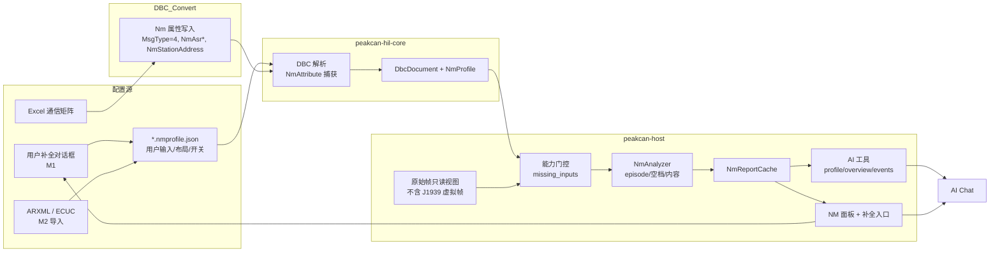
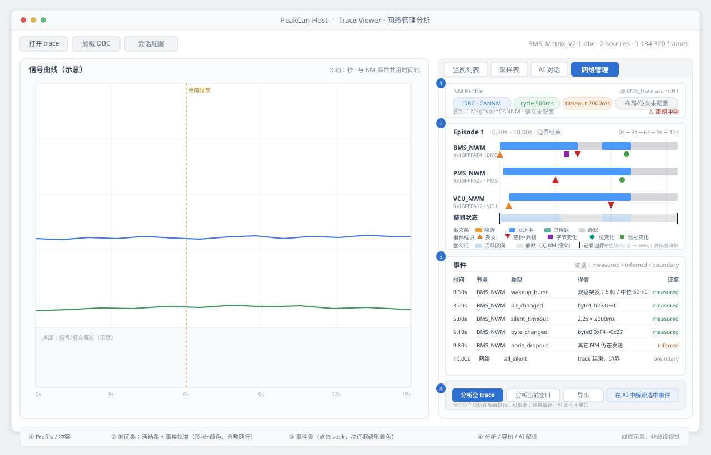

# Trace Viewer 网络管理（NM）报文 AI 分析 — 设计

- 状态：Draft，待评审
- 日期：2026-11-19
- 范围：peakcan-host（桌面端为主）、peakcan-hil-core、DBC_Convert
- 关联需求：在 Trace Viewer 中支持 AI 对网络管理报文内容/行为的分析

## 1. 背景与目标

### 1.1 问题

Trace Viewer 已有 AI 对话与 19 个工具，但所有分析都建立在“DBC 信号”之上：

- 没有 NM 概念：全仓无 `CanNm` / `NmMessage` / 网络管理相关逻辑。
- 没有报文级入口：工具拿不到“按 CAN ID 看原始字节/周期/静默”的能力。
- DBC_Convert 生成 DBC 时写入的 NM 约束（周期、超时、站地址、NM 标记）在 peakcan-host 加载时被 DBC 解析器丢弃。
- NM 的核心问题是时间轴问题（谁唤醒、谁保持、谁掉线、何时释放），信号级工具回答不了。

### 1.2 目标

1. 从 DBC（以及 sidecar）读取项目真实的 NM 约束，而不是在工具里写死 ID 段或布局。
2. DBC 完整时直接分析；DBC 缺项时工具报告 `missing_inputs`，用户通过补全对话框提供最少输入，校验后存 sidecar，完整 DBC 不打扰用户。
3. 由确定性引擎产出可复核的 NM 事实：网络级 episode、节点活动、周期/相位、空档归因、唤醒突发、NID/CBV/用户数据、配置冲突。
4. AI 只做解释与排查建议，所有数字可追溯到工具输出；不把“没看到”说成“睡眠”。
5. 桌面端提供 NM 面板（时间条 + 事件表，可点击 seek）和补全对话框，聊天负责追问与关联分析。
6. 约束管道打通：DBC_Convert 写 NM 实例属性（可选减少输入）→ peakcan-hil-core 解析 → peakcan-host 消费。
7. 在合成数据上锁定行为，再用真实 trace + DBC 做现场口径验收。

### 1.3 非目标

- 不做接收端本地 NM 状态机的 pass/fail 裁决；trace 看不到节点内部状态。
- 不把“总线上没有 NM 帧”等价为“节点睡眠/总线睡眠”。
- 不做在线实时 NM 监控（本期只做离线 trace）。
- 不承诺兼容所有 NM 变体；v1 以 AUTOSAR CanNm 内容布局为基线，OSEK/OEM 私有布局通过配置/内容字典扩展。
- 不改变 DBC 对 CANoe 的既有语义；新增属性使用 DBC_Convert 已定义的 NM 属性名。

### 1.4 术语

| 术语 | 含义 |
|---|---|
| NM 报文 | 网络管理 PDU，按项目约束识别；不等于“所有周期报文” |
| NID | 源节点标识，默认在 payload 字节 0（位置可配） |
| CBV | 控制位向量，默认在 payload 字节 1（位置可配） |
| user data | NID/CBV 之后的用户数据字节 |
| episode | 一次“网络被唤醒 → 节点活动 → 释放 → 静默”的时间段 |
| sender silent | 发送方在一段时间内没有发出 NM 帧（不等于接收方超时） |
| logging gap | 记录仪暂停/丢帧造成的“整段无帧”，不是节点静默 |

## 2. 现状与事实

### 2.1 peakcan-host 的 AI 基础

- 19 个工具、多轮 tool-calling、系统提示词与工具注册在 `ViewModels/TraceViewerViewModel/ChatFlow.cs`（`BuildSystemMessage`、`BuildChatTools`）。
- 工具通过 `Services/ChatTools/IChatToolContext.cs` 拿数据；`GetFrames(sourceId)` 在桌面实现 `ViewModels/TraceViewerViewModel/ChatToolContextFlow.cs` 中**返回全量帧数组副本（`ReplayFrame.Data` 仍共享引用）并并入 J1939 虚拟帧**。
- `TraceSessionRegistry.GetFrames` 每次返回 `ToArray()` 的新副本。
- `ReplayFrame` 字段：`Timestamp, Id, Dlc, Data, Flags, IsExtended, Channel`；**没有 Tx/Rx 方向**。
- ASC 解析器在 `Core/Replay/AscFormat.cs` 中识别 `rx`/`tx` token 后跳过，不落盘方向。
- 工具执行在捕获的 UI 上下文上串行（`ChatFlow.RunChatLoopAsync` 的 `ConfigureAwait(true)`），没有后台分析/进度机制。
- 移动端 `PeakCan.Host.Mobile.Core` 引用 `PeakCan.Host.Core`，有自己的工具集；CLI 独立。

### 2.2 DBC_Convert 的 NM 约束（已核实）

**识别与标记**

- `Core/BoDiagnosticAttributeResolver.Classify`：按 `[NmStartId, NmEndId]` 区间判定 NM，优先级高于 XCP/UDS。
- 命中后写：`BA_ "MsgType" BO_ <id> 4`（枚举索引 4 / 第 5 项为 `CANNM`）与 `BA_ "GenMsgILSupport" BO_ <id> 0`。
- `Core/MessageRangeResolver`：NM 帧（frame type 4）不参与 Cycle 报文的自动错峰偏移。
- `UI/Shell/ShellServices.DiagnosticHitState.Complete`：NM 开关打开但整网无 NM 报文时提示“该网络不存在NM报文id”。

**全局属性（`Core/NmAttributeWriter.Build`，固定 9 行）**

| 属性 | 黄金 DBC 实测值 | 含义 |
|---|---|---|
| `NmBaseAddress` | 1280 (0x500) | NM 基地址 |
| `NmAsrMessageCount` | 256 | NM 报文数量 |
| `NmAsrBaseAddress` | 1280 (0x500) | AUTOSAR 基地址 |
| `NmAsrWaitBusSleepTime` | 2000 | 等待总线睡眠（ms） |
| `NmAsrTimeoutTime` | 2000 | NM 超时（ms） |
| `NmAsrRepeatMessageTime` | 1600 | 重复报文时间（ms） |
| `NmAsrCanMsgCycleTime` | 500 | NM 周期（ms） |
| `NmStationAddress` | `BU_ ECU_B 244` (0xF4) | 节点站地址（当前只写主节点一条） |
| `DBName` | `"CAN_Network"` | 网络名 |

**已定义但未写实例的属性**（`Application/ExcelToDbcService.cs` 的 `BA_DEF_` 段）：

`NmAsrMessage`（BO_，No/Yes）、`NmMessage`（BO_，no/yes）、`NmAsrNode`（BU_，No/Yes）、`NmAsrNodeIdentifier`（BU_，0–255）、`NmAsrCanMsgReducedTime`、`NmAsrCanMsgCycleOffset`、`NmNode`、`NmType`、`NmMessageCount`（全局 INT 2–256）。全仓没有 `BA_ "NmAsrMessage" BO_ ...` 形式的实例写入。

**配置来源**

- `Config/Config.default.ini` 的 `[CANNM]`：`NMControlFrameBaseAddress=0x500`、`NMControlFrameRange=0x500~0x5FF`、`NmMesageCount=256`、`NmStationAddress=0xF4`、`NmAsrWaitBusSleepTime=2000`、`NmAsrTimeoutTime=2000`、`NmAsrRepeatMessageTime=1600`、`NmAsrCanMsgCycleTime=500`。
- 代码内默认值与 ini 可能不同（`Form1.Init_LoadConfig` 中 `NMEndIdentifier` 会被 `NMStartIdentifier + NmMessageCount` 覆盖）。**区间只能当候选，不能当权威判据。**

### 2.3 真实工程配置（S32K148_EAS）

来源：`src/S32K148_EAS_EB_3399A/EAS_Cfg/Arxml/CanNm_CanNm.arxml` 与 `XieNeng_Demo.arxml`。

| 约束 | 值 |
|---|---|
| `CanNmPduNidPosition` | `CANNM_PDU_BYTE_0` |
| `CanNmPduCbvPosition` | `CANNM_PDU_BYTE_1` |
| `CanNmUserDataOffset` / `CanNmUserDataLength` | 2 / 0 |
| `CanNmMsgCycleTime` | 500 ms |
| `CanNmTimeoutTime` | 2000 ms |
| `CanNmRepeatMessageTime` | 1600 ms |
| `CanNmWaitBusSleepTime` | 2000 ms |
| `CanNmImmediateNmCycleTime` / `CanNmImmediateNmTransmissions` | 50 ms / 5 |
| `CanNmActiveWakeupBitEnabled` | true |
| `CanNmPnEnabled` | false |
| `CanNmNodeId` | 0x0（工作区 E51 DBC 有 `NmStationAddress BU_ BMS 244`；工程引用的 29 位矩阵不在本机，BMS 站地址待矩阵确认；两者可能冲突，需按冲突处理） |

真实 NM PDU：

- BMS 发送：`CanConfigSet_Tx_CAN_Network_BMS_NWM`，`CanIfPduCanId = 0x18FFFAF4`，`EXTENDED_NO_FD_CAN`，DLC 8。
- PMS 接收：`CanConfigSet_Rx_CAN_Network_PMS_NWM`，`CanIfPduCanId = 0x18FFFA27`，`EXTENDED_NO_FD_CAN`，DLC 8。
- CAN ID 低字节（F4/27）与站地址（0xF4/0x27）一致；这是本项目的 ID 映射形态，**不是所有项目通用**。

CanIf/CanNm 的 `FilePath` 引用的矩阵文件 `BMS单节点通信矩阵_V2.1_20230605_JG.dbc` 不在本机；现场验收需要用户提供该 DBC 或等价文件。

### 2.4 缺口汇总（36 条）

| ID | 缺口 | 落点 |
|---|---|---|
| A1 | 聊天-only 结果不可复核 | §9 |
| A2 | 没有一键 NM 体检报告 | §9 |
| A3 | NM 配置无界面入口 | §9.2 |
| A4 | 移动端/CLI 未规划 | §14 |
| B5 | DBC_Convert 只定义不写 NM 实例属性 | §6.1 |
| B6 | NM 区间可配且与真实 29 位 ID 可能不符 | §7.2 |
| B7 | NID/CBV/用户数据/瞬时发送只在 ECUC | §6.3 |
| B8 | 只写主节点站地址 | §6.1 |
| B9 | 周期三来源可能矛盾 | §6.4 |
| B10 | DBC 与 trace 可能不是同一张网 | §7.1 |
| C11 | 无 Tx/Rx 方向 | §7.1 |
| C12 | 多源/多通道时钟 | §7.1 |
| C13 | 日志空档 ≠ 节点静默 | §7.5 |
| C14 | 边界截断 | §7.3 |
| C15 | 错误帧/RTR/DLC<2/非单调/FD | §7.1 |
| C16 | J1939 虚拟帧与标准/扩展匹配 | §7.1 |
| D17 | 无网络级 episode | §7.3 |
| D18 | 发送静默 ≠ 接收超时 | §7.5 |
| D19 | 漏帧/延迟/相位偏移 | §7.4 |
| D20 | 共享 NM ID 未按 NID 分组 | §7.2 |
| D21 | CBV 位义依赖功能开关 | §7.7 |
| D22 | 用户数据无语义字典 | §7.7 |
| D23 | 缺根因假设库 | §7.8 |
| D24 | 不可知边界未显式声明 | §7.9 |
| E25 | 证据/推断/结论未分级 | §8.3 |
| E26 | 截断后无钻取 | §8.1 |
| E27 | 与 anomaly_scan 路由冲突 | §8.2 |
| E28 | 成本/缓存/提供商差异 | §8.4 |
| F29 | UI 线程阻塞 | §10 |
| F30 | 全量帧数组拷贝（`Data` 共享） | §10 |
| F31 | HIL.Core 跨仓锁步 | §12 |
| G32 | 无真实 trace/真值对照 | §13 |
| G33 | 负例/变异测试不足 | §13 |
| G34 | 云端 LLM 数据外发/导出敏感数据 | §11 |
| H35 | 每家车企 NM 企标不同，缺少可声明、可版本化、可标定的规范定义层 | §6.5 |
| H36 | DBC 内容不全时缺少结构化的用户输入路径（怎么补、补什么、怎么存） | §6.6 |

## 3. 方案选择

### 3.1 备选方案

| 方案 | 做法 | 结论 |
|---|---|---|
| A. Prompt + 原始帧 | 给 AI 一个 `get_raw_frames`，让模型自己数周期/找空档 | 否决：500ms × 10 分钟=1200 帧，模型数不准；token 贵；易编造 |
| B. 仅聊天工具 | 确定性的两个工具，结果只在聊天里 | 不足以复核：NM 是时间轴/事件表问题 |
| C. 完整状态机裁决 | 按 AUTOSAR 状态机输出 pass/fail | 推迟：接收端状态不可观测，阈值/功能开关差异会造成假阳性 |
| **D. 引擎 + 面板 + 对话（选定）** | 代码出证据、面板复核、AI 解释 | 与现有 J1939 重组页先例一致，可测、可审计 |

### 3.2 原则

1. **代码算，模型说**：所有周期、空档、位翻转、NID 校验由引擎计算。
2. **约束来自项目，不来自模型**：DBC/sidecar/显式参数；模型不许假设 ID 段或字节布局。
3. **证据 / 推断 / 假设三级标注**：面板和工具输出都带 `evidence_kind`。
4. **不可知就说不可知**：接收端超时、总线睡眠、节点内部状态一律列入 `unknowns`。

### 3.3 第一阶段（M1）范围：DBC 优先 + 缺项补全

**主路径**：DBC 完整（NM 标记、周期/超时、NID/CBV 位置或信号、功能开关）→ 直接自动分析，不打扰用户。

**DBC 不全时**：不拒绝分析，也不猜。工具先报告“缺什么、为什么缺、影响哪个能力、建议值”，由用户在“补全 NM 输入”对话框里补；补一次存成 sidecar，下次复用。

**M1 能力分级**：

| 能力 | 完整 DBC 自动 | DBC 缺项时 |
|---|---|---|
| 识别 NM 报文 | `MsgType=CANNM` / `NmAsrMessage=Yes` | 用户从 DBC 报文清单勾选，或按名称/区间候选确认 |
| 周期/超时/静默 | `NmAsrCanMsgCycleTime` / `NmAsrTimeoutTime` / `GenMsgCycleTime` | 用户输入；用实测中位、3×周期给建议 |
| 活动段/空档/日志归因/原始字节/信号 | 帧 + DBC 报文 ID | 自动（不需要补） |
| NID 校验 | DBC 信号/站地址 | 用户指定 NID 字节、映射方式；样本预览 |
| CBV 解码 | DBC 信号/位义 | 用户指定 CBV 字节、位角色 |
| PN/用户数据 | ECUC/用户 | 用户输入开关、PNI 位、用户数据 offset/length |
| 企标规则/内容字典 | M2 | M2 |

**M1 仍不做**：按车企企标下 pass/fail、解释用户数据业务含义、判睡眠/释放状态；这些等 M2。

**AI 口径**：工具返回 `missing_inputs`；AI 只说明缺什么、为什么影响结论、怎么补，不替用户填、不猜。

**补全输入来源**：DBC → ECUC（M2 导入）→ sidecar → 用户手动；建议值永不自动生效。详细机制见 §6.6。

## 4. 总体架构



## 5. 数据契约

### 5.1 NmProfile

M1 只填 `Source/Messages/Timings/Nodes/Conflicts/MissingFields/Provenance`；M2 字段（Standard/Layout/Features/Content/Rules/Exceptions/Unmodeled/IdMapping）为 `null` 或空。这样 M1 不需要伪造布局/NID。

```csharp
public sealed record NmProfile(
    NmProfileSource Source,
    IReadOnlyList<NmMessageDef> Messages,
    NmTimings Timings,
    IReadOnlyList<NmNodeDef> Nodes,
    IReadOnlyList<NmConfigConflict> Conflicts,
    IReadOnlyList<string> MissingFields,
    NmProvenance Provenance,
    // M2-only; null/empty in M1
    NmIdMappingMode? IdMapping = null,
    NmStandardRef? Standard = null,
    NmLayout? Layout = null,
    NmFeatures? Features = null,
    NmContentDictionary? Content = null,
    IReadOnlyList<NmRule>? Rules = null,
    IReadOnlyList<NmException>? Exceptions = null,
    IReadOnlyList<NmUnmodeledRule>? Unmodeled = null);

[Flags] public enum NmProfileSource { Dbc = 1, Sidecar = 2, Session = 4, Overrides = 8 }
public enum NmIdMappingMode { Auto, BasePlusNode, LowByteSourceAddress, SharedId, Explicit }
public sealed record NmStandardRef(string Id, string Vendor, string Version, string? Extends,
    string? SourceDoc, string? SourceRevision);
public sealed record NmRule(string Id, string? RequirementId, string Phase,
    string WhenKind, IReadOnlyDictionary<string,string> WhenArgs,
    string ExpectKind, IReadOnlyDictionary<string,string> ExpectArgs,
    string FindingCode, string Severity, string? SourceRef);
public sealed record NmException(string Id, string? RequirementId, string WhenKind,
    IReadOnlyDictionary<string,string> WhenArgs, string Note);
public sealed record NmUnmodeledRule(string RequirementId, string Text, string Reason);
public sealed record NmProvenance(string? ProfilePath, string? ProfileHash, string ResolvedFrom);
public enum NmCapability { IdentifyMessages, Timing, Activity, RawContent, SignalDecode,
    NidCheck, CbvDecode, PnCheck, UserData, OemRules }
public sealed record NmInputMissing(NmCapability Capability, string InputKey, string Why,
    string? Suggestion, string? SuggestionSource);
public sealed record NmCapabilityState(NmCapability Capability, bool Available,
    IReadOnlyList<NmInputMissing> Missing);
public sealed record NmUserSupplement(
    IReadOnlyList<string>? NmMessageSelectors,
    NmIdMappingMode? IdMapping,
    byte? NidByte,
    byte? CbvByte,
    byte? UserDataOffset,
    int? UserDataLength,
    NmTimings? Timings,
    NmFeatures? Features,
    IReadOnlyList<NmNodeDef>? Nodes,
    string? DbcPath,
    string? DbcHash);
// sidecar = NmUserSupplement 的 JSON 序列化；M2 再加 Standard/Rules/Content。
public sealed record NmMessageDef(string CanIdHex, bool IsExtended, string? Name, string? Sender,
    byte Dlc, bool IsNm, string[] Reasons, int? CycleMs = null, int? TimeoutMs = null,
    bool MarkerAuthoritative = false);
public sealed record NmTimings(int? CycleMs, int? TimeoutMs, int? RepeatMessageMs, int? WaitBusSleepMs, int? ImmediateCycleMs, int? ImmediateCount);
public sealed record NmLayout(byte? NidByte, byte CbvByte, byte UserDataOffset, int? UserDataLength, IReadOnlyDictionary<int,string>? CbvBitNames);
public sealed record NmFeatures(bool? ActiveWakeupBitEnabled, bool? RepeatMsgIndEnabled, bool? PnEnabled);
public sealed record NmNodeDef(string Name, byte? StationAddress, byte? NodeIdentifier, bool IsNmNode);
public sealed record NmConfigConflict(string Field, string[] Values, string[] Sources);
```

字段来源与优先级（逐字段，不整体覆盖）：

| 字段 | 优先级 |
|---|---|
| `Messages` / `Nodes` / `IdMapping` | 工具显式参数 > 会话配置 > DBC 属性 > 默认 |
| `Timings` | 工具显式参数 > 会话配置 > sidecar > DBC 属性 > 默认 |
| `Layout` / `Features` / `Content` | 工具显式参数 > 会话配置 > sidecar > 默认 |
| 冲突 | 不静默解决；写 `Conflicts` 并产出 `NM_CONFIG_CONFLICT` finding |

### 5.2 NmReport

```csharp
public sealed record NmReport(
    NmWindow Window,
    string SourceId,
    ushort? Channel,
    IReadOnlyList<NmEpisode> Episodes,
    IReadOnlyList<NmMessageReport> Messages,   // M1 主行：按报文
    IReadOnlyList<NmNodeReport> Nodes,         // M2；M1 为空
    IReadOnlyList<NmEvent> Events,
    IReadOnlyList<NmFinding> Findings,
    IReadOnlyList<string> Assumptions,
    IReadOnlyList<string> Unknowns,
    IReadOnlyList<NmCapabilityState> Capabilities,
    IReadOnlyList<NmInputMissing> MissingInputs,
    IReadOnlyList<NmTruncation> Truncations,
    string? StandardId = null,                  // M2
    string? ProfileHash = null,                 // M2
    string? EngineVersion = null);

public sealed record NmEpisode(int Index, double Start, double End, string Kind,
    string? WakeupNid, IReadOnlyList<string> Participants, bool BoundaryStart, bool BoundaryEnd);

public sealed record NmMessageReport(string CanIdHex, bool IsExtended, string? Name, string? Sender,
    int FrameCount, double FirstSeen, double LastSeen,
    NmCycleStats Cycle, IReadOnlyList<NmSegment> Activity, bool SilentBeyondTimeout);

public sealed record NmNodeReport(string? Nid, string? CanIdHex, byte? StationAddress,
    double FirstSeen, double LastSeen, int FrameCount,
    NmCycleStats Cycle, IReadOnlyList<NmSegment> Activity,
    bool LeftEarly, bool SilentBeyondTimeout);

public sealed record NmEvent(double T, string Type, string? Node, string? CanIdHex,
    string Detail, int EpisodeIndex, string EvidenceKind); // measured | inferred | boundary

public sealed record NmFinding(string Code, string Severity, string Message,
    IReadOnlyList<double> EvidenceTimes, bool IsInference, string? SuggestedNextCheck,
    string? RuleId = null, string? RequirementId = null, string? SourceRef = null);

public sealed record NmWindow(double Start, double End, string WindowRef);
public sealed record NmCycleStats(double? MedianMs, double? P95Ms, double? MinMs,
    double? MaxMs, double? PhaseMs, int DeviationCount, int IntervalCount = 0,
    int? ExpectedMs = null, int? ToleranceMs = null);
public sealed record NmSegment(double Start, double End, string Kind);
public sealed record NmTruncation(string Section, int Returned, int Total);
```

### 5.3 工具 JSON 契约

所有时间同时给数值和 `*_label`（复用 `TraceTimeFormatter`）。所有输出带 `truncated` 和 `assumptions`。

## 6. 约束管道

### 6.1 DBC_Convert 侧（第一阶段）

在现有 `NmAttributeWriter` 的 9 行之外，补写实例属性：

- `BA_ "NmAsrMessage" BO_ <nm_id> "Yes";`（枚举值必须带引号）
- `BA_ "NmAsrNode" BU_ <node> "Yes";`
- `BA_ "NmAsrNodeIdentifier" BU_ <node> <station>;`
- `BA_ "NmStationAddress" BU_ <node> <station>;`（有站地址的节点都写；当前输入模型只有主节点时，只写主节点并记录缺失）

保留 `MsgType=4` 与 `GenMsgILSupport=0` 作为权威标记；`NmAsrMessage` 作为补充。

**往返约定**：这些属性由 Config.ini + 矩阵在每次 Excel→DBC 时重新生成，不要求 DBC→Excel→DBC 逐字保留；但 DBC→Excel 的语义对比必须不把它们当“差异”误报（或在对比报告中列为“生成属性”）。

### 6.2 peakcan-hil-core 解析（第一阶段）

- `DbcDocument` 增加可空 `NmAttributes`（8 条全局值）与节点/报文上的 `NmAsrNode`、`NmAsrNodeIdentifier`、`NmStationAddress`、`MsgType`、`NmAsrMessage`。
- `ParseDocumentFlow.ParseBaAttributes` 支持三种形式：全局 `BA_ "<name>" <int|string>;`、`BO_ <id> <value>`、`BU_ <node> <value>`。
- `MsgType` 的数值只有在 `BA_DEF_ BO_ "MsgType" ENUM` 列表中对应项名为 `CANNM` 时才解释为 NM；否则回退到 `NmAsrMessage`/名称候选。不能假设索引 4 永远等于 CANNM。
- 属性值不要按 `BA_DEF_` 的 min/max 拦截：黄金 DBC 自身就有 `NmBaseAddress = 1280`（定义范围 1024–1279）与 `NmAsrMessageCount = 256`（定义范围 0–255）。越界记 `NM_ATTR_RANGE_MISMATCH` warning，不丢值。
- 未知/畸形属性跳过，不抛异常；保留现有 `GenMsgCycleTime` 与注释行为。
- 扩展帧键解析沿用现有 `ResolveMessageKey`（IDE bit 兜底）。
- 测试：黄金 DBC 的值、无 NM 属性的旧 DBC 返回 null、扩展帧、字符串枚举引号。
- `PeakCan.HIL.Core` 版本号 bump，peakcan-host 的 `Directory.Packages.props` 锁步更新。

### 6.3 sidecar（第二阶段）

`*.nmprofile.json`，与 DBC 同目录、同名。用于 DBC 无法承载的字段：

```json
{
  "version": 1,
  "source": "ecuc|manual",
  "standard": "project-s32k148-bms@1.0",
  "id_mapping": "low_byte_source_address",
  "layout": { "nid_byte": 0, "cbv_byte": 1, "user_data_offset": 2, "user_data_length": 0 },
  "features": { "active_wakeup": true, "repeat_msg_ind": false, "pn": false },
  "timings": { "cycle_ms": 500, "timeout_ms": 2000, "repeat_message_ms": 1600, "wait_bus_sleep_ms": 2000, "immediate_cycle_ms": 50, "immediate_count": 5 },
  "content": [
    { "byte": 2, "name": "WakeupReason", "values": { "0": "unknown", "1": "kl15", "2": "charger" } }
  ]
}
```

- DBC_Convert 第二阶段可从 ECUC/新配置段生成。
- 缺失时用默认 + 会话配置；不阻塞分析。

### 6.4 合并与冲突

- 逐字段合并（见 §5.1 表）。
- 冲突产出 `NM_CONFIG_CONFLICT`，并在 NM 面板顶部用黄色条展示。
- 典型冲突：DBC 周期 500 vs 报文 `GenMsgCycleTime` 640；ECUC `CanNmNodeId=0` vs DBC 站地址 244；PN 关闭但 CBV 的 PNI 位置 1（这是运行期 finding，不是配置冲突）。

### 6.5 企标包（Standard Profile，M2）

车企网络管理企标差异不能进代码分支，也不能只靠提示词。定义成**声明式、可版本化、可标定的企标包**，引擎只消费规范。

#### 6.5.1 三层继承

```
基础标准（AUTOSAR CanNm R22 / OSEK NM / 私有 keepalive）
   └── 车企企标（OEM overlay：只写差异）
         └── 项目覆盖（具体 DBC/矩阵的 ID、站地址、节点）
```

- 基础标准：字段布局、默认时序、标准位义。
- 车企企标：只写与基础不同的字段/规则/例外；`extends` 指向基础标准。
- 项目覆盖：具体报文 ID、发送节点、站地址、DLC、内容字典；`extends` 指向企标。
- 合并规则：项目 > 企标 > 基础；逐字段覆盖；冲突写入 `Conflicts`。
- 加载时把继承链展平为单一 `NmProfile`；`Provenance.ResolvedFrom` 记录每层来源，报告可追溯。

#### 6.5.2 文件与示例

文件：`profiles/<vendor>/<name>@<version>.nmstd.yaml`（YAML 便于评审/差异；运行时转成 `NmProfile`）。

以 S32K148 工程为例：
```yaml
standard:
  id: project-s32k148-bms
  vendor: internal
  version: "1.0"
  extends: oem-x-cannm@2.1
  source:
    doc: "BMS单节点通信矩阵_V2.1_20230605_JG.dbc / CanNm_CanNm.arxml"
    revision: "2026-11-19"

overrides:
  id_mapping: { mode: low_byte_source_address }
  layout:
    nid: { byte: 0, enabled: true }
    cbv: { byte: 1 }
    user_data: { offset: 2, length: 0 }
  features: { active_wakeup: true, repeat_msg_ind: false, pn: false }
  timing:
    cycle_ms: 500
    timeout_ms: 2000
    repeat_message_ms: 1600
    wait_bus_sleep_ms: 2000
    immediate: { cycle_ms: 50, count: 5 }
    tolerances: { cycle_pct: 20, cycle_abs_ms: 30 }

messages:
  - { name: BMS_NWM, id: 0x18FFFAF4, extended: true, sender: BMS, dlc: 8 }
  - { name: PMS_NWM, id: 0x18FFFA27, extended: true, sender: PMS, dlc: 8 }

nodes:
  - { name: BMS, station_address: 0xF4 }
  - { name: PMS, station_address: 0x27 }

rules:
  - id: wakeup_burst
    requirement: "企标 5.4.2 唤醒后 5 帧 / 50ms"
    phase: wakeup
    when: { kind: silence_then_first_frame, min_silence_ms: 500 }
    expect: { kind: burst, count: 5, interval_ms: 50, tolerance_ms: 10 }
    finding: NM_WAKEUP_BURST_MISMATCH
    source_ref: "5.4.2"
  - id: sender_silence
    requirement: "企标 5.5.1 NM 超时 2000ms"
    phase: normal
    when: { kind: any_nm_frame }
    expect: { kind: max_gap_ms, value: 2000 }
    finding: NM_SENDER_SILENT_BEYOND_TIMEOUT
    source_ref: "5.5.1"

content:
  fields:
    - { byte: 2, name: WakeupReason, values: { "0": unknown, "1": kl15, "2": charger } }

exceptions:
  - id: charging_keep_awake
    requirement: "企标 6.2 充电期间 BMS 必须保持 NM"
    when: { kind: signal_true, signal: ChargingActive }
    note: "充电期间节点静默为违例，不是正常释放"
```

#### 6.5.3 规则原语（v1 受限集合）

不造通用表达式语言；只实现第一批规范需要的**命名原语**，新原语进引擎、不进 OEM 分支：

| 类别 | 原语 | 用途 |
|---|---|---|
| 条件 | `silence_then_first_frame` | 静默后的首帧（唤醒） |
| 条件 | `any_nm_frame` | 每个 NM 帧上下文 |
| 条件 | `node_silent` / `all_nodes_silent` | 节点/全网静默 |
| 条件 | `bit_set` / `bit_clear` | CBV/内容位 |
| 条件 | `field_equals` / `frame_present` / `frame_absent` | 内容/报文存在性 |
| 条件 | `signal_true`（第二阶段） | 与业务信号相关（如充电中）；v1 未实现时标 `Unmodeled` |
| 期望 | `burst` | 唤醒 5×50ms 类序列 |
| 期望 | `max_gap_ms` / `min_gap_ms` | 超时/最小间隔 |
| 期望 | `frame_count` / `bit_sequence` / `field_sequence` | 重复报文/位序列/内容序列 |
| 期望 | `counter_increment` | 私有 keepalive 的计数 |
| 期望 | `nid_equals` | NID 与站地址/ID 映射一致 |
| 期望 | `observe_silence_ms` | 等待睡眠观察窗 |

- 组合原语（`all_of`/`any_of`/`not`）第二阶段再加；v1 用多条规则表达。
- 任何原语不认识的规则 → `Unmodeled`，分析报告明确“该企标条款未建模”，AI 不许给结论。
- 新增原语必须有单元测试 + 至少一个 profile fixture；不允许 `if (vendor == ...)` 的代码分支。

#### 6.5.4 企标校验器

profile 加载/保存时校验：

- NID/CBV 字节 < DLC；NID 与 CBV 不重叠。
- user data 区间在 DLC 内。
- `timeout_ms > cycle_ms`；`repeat_message_ms >= cycle_ms`；immediate 序列总时长合理。
- 报文 ID/扩展标志与 DBC 一致；节点站地址 0–255。
- 规则引用的位/字节存在；finding code 已注册。
- `requirement`/`source_ref` 必填（可追溯）。
- 继承链可解析、无循环；覆盖字段合法。

校验失败不允许进入分析；UI 标红并给出条款/字段位置。

#### 6.5.5 标定（calibration）

新企标包必须先在“已知良好”的 trace 上标定：

1. 载入 profile + golden trace（同一项目、已知无故障的一段）。
2. 引擎输出应与 profile 期望一致；golden 上不应出现 warn（info/boundary 允许）。
3. 对每条规则做**注入故障**：改周期、删帧、改 NID、置 PNI、改内容位；每条必须触发对应 finding。
4. 标定报告（观测 vs 期望、未触发规则、误报）随 profile 存档。
5. 锁定 `profile_hash` + golden fixture；之后每次改 profile 重跑。

#### 6.5.6 版本、溯源与治理

- 每个 finding 带 `requirement_id` + `source_ref`（企标条款/页码）；报告可回答“违反企标哪一条”。
- 报告头写 `standard_id@version + profile_hash`；AI 引用结论时必须带这两个。
- profile 与 fixture 进版本库（涉密企标可放本地 profile 库，不进公共仓）。
- 企标升版：新版本文件 + diff + 重新标定；旧版本保留以复现历史报告。
- 可生成“企标条款 → 规则 ID → finding → fixture”追溯矩阵，供评审/ASPICE 使用。

#### 6.5.7 选择与匹配

- 优先级：会话显式选择 > DBC/sidecar 的 `standard_ref` > `DBName`/项目路径匹配 > 手动选择。
- 匹配不到时：只做**候选识别**，不产出权威 finding；面板显示“未选择企标”，AI 必须说明。
- 多个匹配时让用户选；禁止静默选一个“最像”的。

#### 6.5.8 与 AI 的关系

- AI 不负责“记住企标”；它只读 profile 和工具输出。
- 可选：AI 从企标文档草拟 profile（字段/规则/条款映射），但必须人工评审 + 校验器 + 标定后生效；草拟结果永不直接用于分析。
- AI 可以解释“某条 finding 对应企标哪一条”，但不能发明条款。

### 6.6 缺项补全与用户输入（M1）

#### 6.6.1 能力—输入矩阵

每个分析能力只在所需输入齐备时启用；缺项不是“拒绝分析”，而是“降级 + 提示补什么”。

| 能力 | 必需输入 | DBC 自动来源 | 缺项时的建议 | 补全后解锁 |
|---|---|---|---|---|
| 识别 NM 报文 | NM 标记或报文选择 | `MsgType=CANNM` / `NmAsrMessage=Yes` | 名称 `*_NWM`、全局 NM 区间、实测周期 | 报文集合 |
| 周期统计 | 报文周期 | `NmAsrCanMsgCycleTime` / `GenMsgCycleTime` | 实测间隔中位数 | 周期偏差 |
| 超时/静默 | timeout | `NmAsrTimeoutTime` | `3 × cycle`（标注假设）或用户输入 | 超时静默 |
| 活动/空档/原始字节 | 无 | 帧 | — | 总是可用 |
| DBC 信号摘要 | DBC `SG_` | DBC | — | 信号值摘要 |
| NID 校验 | NID 字节 + 期望映射 | DBC 信号/站地址 | 恒为站地址/CAN ID 低字节的字节位；匹配率 | NID 不符/变化 |
| CBV 解码 | CBV 字节 + 位角色 | DBC 信号/用户 | 取值少、位翻转明显的字节；位角色不自动猜 | 位事件/PNI |
| PN 判定 | PN 开关 + PNI 位 | ECUC/用户 | 不自动建议开关 | PNI 异常 |
| 用户数据 | offset / length | ECUC/用户 | 尾部全零 → 建议 length 0 | 用户数据异常 |
| 企标规则 | 企标包 | M2 | — | 企标合规（M2） |

#### 6.6.2 输入来源与优先级

逐字段合并，冲突不静默：

1. 用户在补全对话框/会话里显式填的值（最高，标注 `user_override`）。
2. DBC 属性/信号。
3. ECUC/ARXML 导入（M2）。
4. 工具建议值（永不自动生效，必须用户确认）。

- 用户只补“当前问题需要”的项，不强迫一次填全。
- 同一字段 DBC 与用户值不同：面板并列显示，用户选一个；选中的值写入 sidecar。
- 建议值必须带理由（如“byte0 在 1200 帧中恒为 0xF4，且 CAN ID 低字节也是 0xF4”）。

#### 6.6.3 补全对话框

线框图见 `assets/2026-11-19-nm-input-wizard.svg`。

- **左侧缺项列表**：能力名、原因、影响、状态（自动/DBC/需输入/用户已填）。
- **中间样本预览**：取当前 trace 的 1–3 帧 NM 候选，按字节/位显示；点击字节可设为 NID/CBV；右侧实时显示解码结果。
- **右侧编辑区**：当前选中项的输入控件 + 建议值 + “采用建议”。
- **底部**：`试算当前窗口`、`保存到项目`、`取消`。
- 只弹缺项；如果用户只问周期，不弹 NID/CBV。
- 试算显示：识别到的报文、周期、NID 分布、空档、突发；用户确认后保存。

#### 6.6.4 建议算法（确定性，不自动应用）

- NM 报文：DBC 标记 > 名称 `*_NWM`/`*NM*` > 全局 NM 区间 > 实测周期 + 8 字节候选。
- ID 映射：对观测帧测试 `base+node` / `low_byte=SA` / `shared_id` / `explicit`，给出匹配率与样本。
- NID 字节：逐字节检查“同一发送者恒定、且等于站地址或 CAN ID 低字节”的比例；给出 top-2 候选和证据。
- CBV 字节：逐字节统计 distinct 值、位翻转次数；只给候选，不猜位角色。
- 周期：有效间隔中位数；样本 < 5 时不给建议。
- 超时：DBC/ECUC 优先；否则 `3×cycle` 建议并标注“假设”。
- 用户数据：尾部字节全零 → 建议 length 0；否则建议 offset 后全部为用户数据，需用户确认。

#### 6.6.5 校验与试算

- 必填校验：NID/CBV 字节 < DLC、互不重叠；user data 区间在 DLC 内；timeout > cycle；station 0–255；报文 ID/扩展标志存在于 DBC 或 trace。
- 试算：在选中窗口跑一次轻量分析，展示“按当前输入会得到什么”；用户可回改。
- 试算不写报告缓存；只有“保存到项目”后才持久化。

#### 6.6.6 持久化与 DBC 重生成

- 保存为与 DBC 同目录同名的 `*.nmprofile.json`（sidecar），或存进 trace session bundle；记录 `dbc_path + dbc_hash + created_at + profile_version`。
- 下次加载同一 DBC 自动套用；DBC 变更时逐字段比对，冲突提示用户。
- Excel→DBC 重生成不会丢用户输入（输入在 sidecar，不在 DBC）。
- 支持导出/导入 sidecar，便于团队共享；涉密项目可只放本地。

#### 6.6.7 AI 交互

- `get_nm_profile` / `get_nm_overview` 返回 `capabilities` 与 `missing_inputs`（能力、字段、原因、建议、来源）。
- AI 必须先说明“当前能做/不能做”，再给结论；缺项时引导用户打开补全对话框或粘贴 sidecar。
- **AI 不直接写 sidecar**。用户可在聊天里说“NID 在 byte0”，AI 可以复述并请用户在对话框确认；M2 可加 `propose_nm_supplement` 返回草稿，仍由用户应用。
- 补全保存后，工具重新读取 profile，返回新能力与结果。

#### 6.6.8 例子

- S32K148（DBC 完整）：识别、周期、NID、CBV、PN、用户数据全部自动可用，不弹补全。
- `pure_electric_v4.6.dbc`（有全局 NM 属性、无标记）：补全对话框列出“选择 NM 报文”；用全局区间/名称/周期给候选，用户勾选后即可做周期/静默/原始字节；NID/CBV 位继续提示补全。
- 只有 MDB 报文、无 NM：补全列出 DBC 报文清单 + “该 DBC 未发现 NM 候选”，用户可手动添加 ID；不猜。

## 7. 分析引擎

### 7.1 帧选择与归一化

- 输入：每个源的**原始帧只读列表**（不含 J1939 虚拟帧），按 `(sourceId, Channel)` 分组。
- 过滤：`FrameFlags.ErrFrame` 不计入正常统计，单列 `malformed/error`；RTR 不计入 NM；`Dlc < 2` 标记 `NM_FRAME_TOO_SHORT`。
- ID 匹配：`IsExtended` 必须与 DBC 的 IDE bit 一致；比较时用 `Id & 0x1FFFFFFF`。
- 方向：`ReplayFrame` 增加 `bool? IsTransmit`（默认 null = 未知）；ASC 从 `rx`/`tx` 填入，BLF 在确认字段前保持 null。M1 默认**不排除** Tx（避免同一记录转 ASC/BLF 得到不同结果），只报 `direction=unknown` + `tx_frames` 计数；M2 才可配置是否排除记录仪自身回显。ASC 解析器同步补 RTR/错误帧标记，保证与 BLF 口径一致。
- 时间：非单调时间戳先排序并记 `NM_TIMESTAMP_REGRESSION`；跨源不混算（NM 分析一次只针对一个 source/channel）。
- 显示过滤 `CanIdFilter` 不作用于分析（它只是视图过滤）；如果过滤会隐藏 NM ID，面板提示。

### 7.2 ID 映射模式

| 模式 | 规则 | 适用 |
|---|---|---|
| `base_plus_node` | NM ID = `NmBaseAddress + station`；期望 NID = station | 常见 0x5xx |
| `low_byte_source_address` | CAN ID 低字节 = station；期望 NID = station | S32K148（0x18FFFAF4 ↔ 0xF4） |
| `shared_id` | 所有节点用同一 ID；按 payload NID 分组 | 单 ID 广播式 NM |
| `explicit` | 每个节点显式映射 ID/NID | OEM 私有 |

- `Auto`：对观测帧尝试各模式，选择解释度最高者（ID 与 NID/站地址一致率 ≥ 90%），标记为 `inferred`，面板需用户确认后才作为权威。
- 识别优先级：`MsgType`（经 `BA_DEF_` 枚举确认等于 CANNM）> `NmAsrMessage=Yes` > 名称/注释含 `NM`/`NWM`（候选）> 区间候选。前两者为 `authoritative`，后两者为 `heuristic`；`MsgType` 枚举未确认时降级为候选。

### 7.3 Episode 分割

- NM 静默阈值 = `Timings.TimeoutMs`（默认 2000ms）。
- Episode 开始：静默 ≥ 阈值后的第一个 NM 帧；若 trace 开头就有 NM，标 `BoundaryStart`。
- Episode 结束：所有 NM 静默 ≥ 阈值；若 trace 结束时仍未达到，标 `BoundaryEnd` + `indeterminate_end`。
- Episode 内阶段（推断）：
  - `wakeup`：首帧 + 观察窗（M1 用观察到的突发或 `RepeatMessageMs`；M2 才用 immediate 配置做合规对比）。
  - `normal`：其余活动期。
  - `release`：某报文最后一帧后，其它 NM 报文仍在发送（M1 按报文；M2 按 NID）。
  - `all_silent`：全部停止到 episode 结束。
- 参与：M1 按报文首帧/末帧；M2 才按 NID 拆节点与加入顺序。

### 7.4 周期与相位

- M1 按报文统计间隔：median / p95 / min / max；基线优先用报文级 `NmMessageDef.CycleMs`，缺失时用全局 `Timings.CycleMs`；两者冲突照报。
- 统计前剔除跨 `missed_frame`/`sender_silent`/episode 边界的间隔；间隔样本 < 5 时只报 `insufficient_samples`，不下 deviation 结论。
- 容差默认 `max(0.2 × cycle, 30ms)`；可配。
- 记录相位（相对 episode 首帧）与偏移漂移；不把固定 offset 当漏帧。
- `NM_CYCLE_DEVIATION`：有效间隔中偏差占比 > 5% 或连续 3 帧超出容差；共享 ID 无法拆节点时抑制该结论。

### 7.5 空档与日志归因

按以下优先级判定，先网络级、后单报文：

1. **全部 NM 报文静默** ≥ timeout → `NM_ALL_NM_SILENT`（观察，不是故障；可能是正常释放/下电）。此时不再对每个报文报 dropout/timeout。
2. **部分 NM 报文静默**，其它 NM 报文仍在发送 → `NM_NODE_DROPOUT`（按报文，推断）。
3. **整个总线无任何帧** ≥ `max(2×cycle, 500ms)` → `NM_BUS_WIDE_SILENCE` + `unknowns: recorder_gap_or_bus_sleep`；不判 dropout。
4. 只有存在时间戳跳变/回退等可验证证据时，才额外记 `NM_LOG_GAP_SUSPECTED`。
5. 空档触及 trace 开头/结尾 → `NM_TRACE_BOUNDARY`，不计为故障。
6. 单报文间隔 > 1.5 × cycle 且 ≤ timeout → `missed_frame`；> timeout 且其它 NM 仍在发送 → `NM_SENDER_SILENT_BEYOND_TIMEOUT`。

- 所有 finding 附“证据时间 + 归因依据”，不直接下“睡眠/掉线”结论。

### 7.6 唤醒与突发

- 突发：静默 ≥ cycle 后，出现 ≥ 2 个间隔 < 0.5 × cycle 的连续帧。
- 若配置了 `ImmediateCycleMs/Count`，对比期望序列（本工程 5 × 50ms），产出 `NM_WAKEUP_BURST_MATCH/MISMATCH`。
- 唤醒源候选：episode 首帧的 NID（多个则列出）。
- 主动唤醒位：`Features.ActiveWakeupBitEnabled == true` 时，CBV 对应位 0→1 记 `NM_ACTIVE_WAKEUP`；关闭时不解释该位。

### 7.7 NID / CBV / 用户数据

- NID：
  - 有 `NidByte` 时取字节；统计取值分布、首末时间。
  - 期望值：发送节点的 `StationAddress`；无站地址时按 ID 映射模式推导。
  - `NM_NID_MISMATCH`（NID ≠ 期望）、`NM_NID_CHANGED`（同一发送者中途变化）、`NM_UNKNOWN_NID`（不在 DBC 节点表）。
- CBV：
  - 逐位翻转事件（bit 0–7）；原始位永远照报。
  - 仅在 `Features` 明确时附带标准位名（bit0 RMR、bit3 Active Wakeup、bit4 PNI 等，AUTOSAR 版本差异需注明）。
  - `NM_PNI_WHILE_PN_DISABLED`：PN 关闭但 PNI 位置 1。
- 用户数据：
  - `UserDataLength` 已知为 0：字节 2–7 非零 → `NM_USER_DATA_UNUSED_NONZERO`。
  - 长度未知：报 distinct payload 数、每字节取值分布，不判异常。
  - 有内容字典：按字节/位解码，变化点记事件。
  - DBC 在 NM 报文上定义了信号：复用信号解码，给 min/max/变化摘要。

### 7.8 Findings 与根因假设

Finding 只描述“观测 + 可能方向”，不下 pass/fail。首批 code：

| Code | 阶段 | 条件 | 方向 |
|---|---|---|---|
| `NM_ALL_NM_SILENT` | M1 | 全部 NM 报文静默 ≥ timeout | 正常释放/下电/记录停止（观察，不判故障） |
| `NM_NODE_DROPOUT` | M1 | 部分 NM 静默，其它 NM 仍发送 | 节点复位/掉线/发送停止 |
| `NM_BUS_WIDE_SILENCE` | M1 | 全网无帧 ≥ max(2×cycle, 500ms) | 下电/记录停止/总线故障（未知项） |
| `NM_LOG_GAP_SUSPECTED` | M1 | 存在时间戳跳变/回退等可验证证据 | 记录仪丢帧 |
| `NM_SENDER_SILENT_BEYOND_TIMEOUT` | M1 | 单报文静默 > timeout 且其它 NM 仍发送 | 发送端静默/掉线 |
| `NM_CYCLE_DEVIATION` | M1 | 周期偏差超阈值（样本 ≥5） | 调度/负载/时钟 |
| `NM_MESSAGE_ABSENT` | M1 | DBC 配置的 NM 报文在窗口内从未出现 | 矩阵/记录/节点缺失 |
| `NM_DLC_MISMATCH` | M1 | 实测 DLC ≠ DBC DLC | 帧格式/配置 |
| `NM_TRACE_BOUNDARY` | M1 | 空档/活动触及 trace 首尾 | 记录边界，不是故障 |
| `NM_TIMESTAMP_REGRESSION` | M1 | 时间戳非单调 | 记录文件异常 |
| `NM_CONFIG_CONFLICT` | M1 | DBC 内周期属性冲突（M2 扩展到 profile） | 先统一配置 |
| `NM_STUCK_WAKEUP` | M2 | 短周期内反复 wakeup/突发，无正常期 | 卡唤醒源/重复报文请求 |
| `NM_NID_MISMATCH` | M2 | NID ≠ 期望 | 配置/发送内容错误 |
| `NM_ID_STATION_MISMATCH` | M2 | CAN ID 低字节 ≠ NID/站地址 | 映射配置错误 |
| `NM_WAKEUP_BURST_MISSING` | M2 | 配置了 immediate 但未见突发 | 唤醒序列未按配置发送 |
| `NM_WAKEUP_BURST_MISMATCH` | M2 | 突发间隔/次数与 immediate 配置不符 | 唤醒序列/丢帧 |
| `NM_FRAME_TOO_SHORT` | M2 | DLC 不足以覆盖 NID/CBV | 帧格式/配置 |
| `NM_NID_CHANGED` | M2 | 同一发送者的 NID 中途变化 | 节点/配置 |
| `NM_UNKNOWN_NID` | M2 | NID 不在 DBC 节点表 | 矩阵缺失/未知节点 |
| `NM_PNI_WHILE_PN_DISABLED` | M2 | PNI 置位且 PN 关闭 | 配置不一致 |
| `NM_USER_DATA_UNUSED_NONZERO` | M2 | 长度 0 但字节非零 | 内容不符合约束 |
| `NM_UNEXPECTED_NODE` / `NM_EXPECTED_NODE_MISSING` | M2 | 节点集合与 DBC 不符 | 矩阵/节点状态 |

- **阶段是交付批次，不是启用门**；启用门是 §6.6 的“所需输入齐备”。M1 交付阶段=M1 的 code；NID/CBV/PN/用户数据能力在 M1 中只要用户补全对应输入也可启用（企标规则仍在 M2）。
- M1 的 `NM_CONFIG_CONFLICT` 只指 DBC 内周期冲突；M2 扩展到 profile 冲突。
- `NM_BURST_OBSERVED` 是事件（info），不是 finding：只报“观察到短突发（帧数/间隔）”，不判是否符合 5×50ms。

每个 finding：`Severity ∈ {info, warn}`、`IsInference`、`EvidenceTimes`、`SuggestedNextCheck`。

### 7.9 不可知项（必须出现在 `Unknowns`）

- 接收端本地 NM 超时状态（trace 只看到发送）。
- 真正的总线睡眠（只能观察“NM 静默”，不能证明睡眠）。
- 节点内部状态机/唤醒原因（除非内容字典定义了对应字节）。
- 未录制节点是否存在。
- 记录仪是否丢帧（只能给出 `log_gap_suspected`）。
- 跨网关/多通道复制导致的重复帧归属。

## 8. AI 层

### 8.1 工具

| 工具 | 参数 | 输出 |
|---|---|---|
| `get_nm_profile` | `source_id?`, `channel?` | DBC 约束（M1）/profile（M2）、识别理由、冲突、`capabilities`、`missing_inputs`（含原因/建议）、下一步提示 |
| `get_nm_overview` | `source_id?`, `channel?`, `t_start?`, `t_end?`, `window_ref?` | episode 摘要、`messages`（M1）/`nodes`（M2）、top findings、`capabilities`、`missing_inputs`、`unknowns`、`direction`、assumptions |
| `get_nm_events` | `episode_index?`, `subject?`, `types?`, `page?`, `page_size?` | 分页事件（默认 50，最大 200），`next_page` |
| `analyze_nm_window`（M2） | `can_ids?`, `t_start`, `t_end`, `window_ref?` | 窗口内每 ID/节点详细证据（周期、NID、CBV、用户数据、空档、突发） |

- M1 只注册前 3 个工具；`analyze_nm_window` 随 M2 的布局/语义一起开放。
- M1 的 `get_nm_events` 事件类型是报文级（周期、空档、观察突发、原始字节/位变化、DBC 信号变化），不产出 NID/CBV/PN/睡眠结论。
- `source_id` 默认 master；多源时必须显式指定；`channel` 未指定时若存在多个通道则报错，不混算。
- AI 工具**不提供 `overrides`**：布局/时序只能由用户在 M2 配置会话里改，避免模型改参数后自证。
- 所有工具走 `ChatToolBase`，错误以 `{"error":..., "hint":...}` 返回。
- 所有输出带 `unknowns`；M1 带 `dbc_path`/`dbc_hash`/`semantics_available=false`，M2 再加 `standard_id@version`/`profile_hash`/`unmodeled_rules`。
- 输出上限：overview ≤ 20 episodes/50 messages/30 findings；window ≤ 8 messages/200 events/20 gaps/20 bursts；`include_raw` 显式开启时最多 20 帧。
- `get_nm_events` 的钻取基于缓存 report，不重新扫帧。
- `get_nm_profile` 在 DBC 无 NM 标记时返回 `missing_inputs`（能力=`IdentifyMessages`、原因、候选建议），建议打开补全对话框；用户勾选/提供 ID 后即可分析，不猜 0x5xx。DBC_Convert 写 29 位标记是可选的“减少输入”改进。

### 8.2 系统提示词

M1 与 M2 使用两套提示词；M1 不引用企标/profile/NID/CBV。

**M1 规则**（`BuildSystemMessage` 的 NM 章节）：

1. 任何 NM/网络管理/睡眠/唤醒/掉线问题，先 `get_nm_profile`；只分析 DBC 标记为 authoritative 或用户在补全对话框确认过的报文。
2. 只引用工具返回的数字与 `*_label`；禁止自行换算时间。
3. “trace 里没有 NM 帧”只说明该窗口/文件内没有，不等于睡眠/掉线。
4. NID/CBV/PN/用户数据/睡眠/企标：先看 `capabilities`/`missing_inputs`；缺输入就说缺什么、影响哪条结论、怎么补（打开补全对话框/sidecar），未补前不下结论，不许脑补。
5. 只列周期偏差、静默、观察突发、原始字节/位/信号变化、配置冲突，并给证据时间。
6. 允许给根因假设，但必须标“假设”，并给下一步排查建议（如查看某信号/某报文）。
7. 与 `anomaly_scan` 的分工：NM 行为由 NM 工具负责；`anomaly_scan` 只在用户明确要求全信号扫描时使用。
8. 可以用现有 `seek_to` / `propose_to_watch_list` 跳转或加 watch；不改 DBC/配置。
9. 不引用 `standard_id`/`profile_hash`/`unmodeled_rules`（M1 不存在）。
10. 不替用户填 sidecar、不直接改配置；用户口述的值只能复述并请其在对话框确认。

**M2 追加规则**：

11. 引用 `standard_id@version` + `profile_hash`；存在 `unmodeled_rules` 时明确说“该企标条款未建模”，不许给结论。
12. NID/CBV/PN/内容字典只引用 profile/assumptions；配置冲突、NID 不符等作为 finding 列出并给证据时间。

### 8.3 证据分级与输出

- 工具输出 `evidence_kind`: `measured` / `inferred` / `boundary`。
- AI 回答必须区分“测到的事实”“推断”“不可知”。
- 没有 `NM_CONFIG_CONFLICT` 证据时，不许说配置错了；没有 NID 样本时，不许说 NID 正常。

### 8.4 缓存、成本与提供商

- `NmReportCache` key：`(sourceId, channel, frameCount, dbcHash, supplementHash, profileHash, window, engineVersion)`；load/unload/DBC/sidecar 变更时失效。
- overview/window/events 复用缓存；钻取不重扫。
- 默认只把摘要（计数、事件、时间、NID/CBV 数值、DBC 名称）发给 LLM；原始用户数据字节默认不发（§11）。
- 提供商 tool-call 上限：M1 3 个、M2 4 个 NM 工具 + 现有 19 个工具；提示词要求优先用 `overview`，避免一轮调太多。

## 9. UI

### 9.1 NM 面板

新增右侧 “网络管理” 标签（与“监视列表/采样表/AI 对话”并列），线框图见 `assets/2026-11-19-nm-ai-analysis-ui.svg`。



结构：

1. **Profile 条**：显示来源、NM 报文数、周期、超时、识别依据；**观测摘要**（窗口内观测 X/Y 条 NM 报文、未出现报文 ID/名称）——时间条只给窗口内观测到的报文建行，缺行原因必须在这里说明；能力 chips（识别/周期/NID/CBV/PN/用户数据）+ **“缺项 N → 补全”按钮**。缺项由 §6.6 的补全对话框处理；M2 再增加企标包/冲突标记。
2. **时间条**：默认每个 NM 报文一行（按 DBC 发送节点标注）；补全 NID 映射后可切换到按 NID 拆行。每行 = **活动条**（唤醒/发送中/已释放/静默，Viewbox 横向缩放）+ **独立事件轨道**（像素空间绘制、固定 9px、形状+颜色双编码：▲ 突发 / ▼ 超时空档 / ■ 字节变化 / ◆ 位变化 / ● 信号变化 / │ 记录边界）。**整网行** = 活跃区间 / 静默带 / 边界与总线空档标记；静默带先减去 episode 覆盖再合并，禁止覆盖活动段；窗口头部静默（`NM_TRACE_BOUNDARY`，证据为窗口起点→首 episode 起点）画灰带。时间条底部常驻**时间轴**（窗口起止 + 中点）与**三行图例**。点击活动段或标记 → seek。
3. **事件表**：时间、节点/报文、类型（中文）、详情、证据级别（实测/推断/边界）；M1 类型为报文级（周期偏差、静默、突发、字节/位/信号变化），M2 才有 NID/CBV/PN 语义事件；筛选仍按引擎的 snake_case 类型契约、点击行 seek。
4. **操作**：分析全 trace / 分析当前窗口 / 导出 Markdown+CSV / 在 AI 中解读选中事件。
5. **状态**：分析中（后台，可取消）、空态、错误态；M1 在顶部固定显示“语义未配置：NID/CBV/PN/用户数据不做判定”。

### 9.2 补全对话框（M1）与企标配置（M2）

**M1 补全对话框**：DBC 缺项时由“缺项 N → 补全”打开；结构见 §6.6 和 `assets/2026-11-19-nm-input-wizard.svg`。左侧缺项、居中 hex 预览、右侧编辑/建议、底部试算与保存；保存为 `*.nmprofile.json`。

**M2 企标配置**：在补全结果之上选择/导入企标包（基础→车企→项目）、编辑规则/例外/内容字典、标定。

- 企标包：选择/导入/新建（基础标准 → 车企企标 → 项目覆盖），显示继承链、版本、`profile_hash`
- ID 映射模式（Auto/BasePlusNode/LowByteSourceAddress/SharedId/Explicit）
- NM 报文列表（DBC 候选勾选 + 手动添加 ID/扩展标志）
- 布局：NID 字节（可选）、CBV 字节、用户数据偏移/长度
- 时序：周期、超时、重复报文、等待睡眠、瞬时发送
- 功能开关：主动唤醒位、RMR、PN
- 内容字典：字节/位 → 名称/取值（第二阶段）
- 校验：cycle > 0、timeout ≥ cycle、NID/CBV 字节 < DLC
- 企标校验：规则引用的位/字节存在、条款号/source_ref 必填、继承链无循环
- 标定：在当前 trace 或 golden trace 上试算，显示“观测 vs 期望”和未建模条款
- 保存到 trace session bundle；提供“恢复 DBC 值”

### 9.3 导出

- Markdown 报告：profile、episodes、nodes、findings、unknowns、证据表。
- CSV：events 平铺，便于 Excel。
- 导出前提示包含 DBC/节点名，询问是否脱敏。

### 9.4 空态/错误态

- 无 DBC：提示先加载 DBC；M1 不提供“手动指定 NM ID”（那是 M2 配置）。
- DBC 有 NM 全局属性但无 NM 标记：自动打开补全对话框，列出按全局区间/名称/周期得到的报文候选，用户勾选后进入分析；不要求先改 DBC。
- DBC 无任何 NM 属性：提示“该 DBC 未包含 NM 配置”，不猜 ID/区间。
- 窗口内无 NM：显示“本窗口未发现 NM 帧”，不推断节点状态。
- 分析取消/超时：保留已有部分结果并标注 `partial`。

## 10. 性能与并发

- **后台执行**：`NmAnalyzer` 在 `Task.Run` 运行；工具 `ExecuteCoreAsync` 异步等待；取消令牌贯穿；UI 线程只做 seek/渲染。
- **快照**：在 UI 线程先取 `(sourceId, channel, frames 只读引用, dbcHash, loadGeneration)` 快照，再 `Task.Run`；不在后台访问 `TraceSessionRegistry._sources`（无锁字典，load/unload 会竞态）。
- **零拷贝**：新增 `GetRawFramesView(sourceId)` 返回 `ITraceViewerService.LoadedFrames` 的只读视图，不含 J1939 虚拟帧；仅在分析路径使用。帧列表加载后不可变；分析过程禁止修改。
- **一次遍历**：按 NM ID 集合过滤并同时构建 episode/报文/事件；避免每个 ID 重扫。
- **原始内容压缩**：字节/位只存变化段（起止 + 值 + 计数），每字节/每总事件设上限；连续递增计数器单独识别，避免 1M 帧 → 1M 事件。
- **缓存 key**：M1 = `(sourceId, channel, frameCount, dbcPath+mtime+NM attrs hash, supplementHash, window, engineVersion)`；换 DBC/sidecar 必须失效；M2 再加 `profileHash`。
- **内存**：不保存逐帧解码对象；事件/段压缩后存储；超限截断并给 total。
- **目标**：100 万帧全 trace overview < 2s（AC7 写死）；UI 线程单次阻塞 < 100ms。
- **进度**：分析 > 500ms 时显示进度/取消。

## 11. 隐私

- M1 默认发给 LLM：计数、事件类型、时间、字节索引/位索引、变化次数、DBC 报文/发送节点名；**不发**字节取值、用户数据原始字节、完整 DBC、完整帧列表。取值只在本地面板显示。
- M2 默认可发 NID/CBV 数值（分析必需），仍不发用户数据原文；内容字典的取值名按需发。
- 提供“允许发送原始 payload”开关（默认关），仅对当前会话生效；M1 原始值分析可在离线报告模式完整使用。
- 本地模型/自定义 API Base 走现有 `ChatSettingsFlow`，作为保密切换。
- 离线模式：不调用 LLM 也能生成确定性报告。
- 企标包可能包含 OEM 敏感阈值/内容字典：默认只保存在本地 profile 库，不上传；AI 只接收 `standard_id@version` 和摘要，不接收条款正文（`UnmodeledRule.Text`）。
- 导出报告前提示可能包含项目敏感信息。

## 12. 跨仓改动与顺序

| 顺序 | 仓库 | 改动 | 依赖 |
|---|---|---|---|
| 1 | peakcan-hil-core | DBC 模型/解析补 NM 属性 + 测试 + 版本 bump | 无 |
| 2 | DBC_Convert | 写 NM 实例属性 + 黄金/往返测试 | 属性名契约 |
| 3 | peakcan-host | 引擎 + 工具 + 面板 + 配置 | 1、2 |
| 4 | peakcan-host Mobile/CLI | 复用引擎的轻量入口 | 3 |

- HIL.Core 是兄弟仓、CI 有版本锁步：peakcan-host 的 `Directory.Packages.props` 与 hil-core 默认分支必须同步。
- 若 HIL.Core 改动被阻塞：备选是 peakcan-host 侧加 `NmAttributeScanner`（只读 DBC 文本抓这几条属性），但会多一份编码/解析副本；默认不走。
- DBC_Convert 的改动与其 UI 解耦，可在 Core 层完成并加测试。

## 13. 测试与验收

### 13.1 单元/集成

**M1**：

- HIL.Core：9 条全局属性、`MsgType` 枚举确认、`NmAsrMessage`、节点站地址、扩展帧、旧 DBC 无属性、`pure_electric_v4.6.dbc`（有全局属性无标记）解析后 `semantics_available=false`。
- DBC_Convert：黄金 DBC 新增 BA_ 行；29 位 NM 标记（显式列表/区间）；重复转换幂等。
- Host.Core：episode 分割（开始/结束/边界）、逐报文周期/相位/容差、样本不足、全 NM 静默、单报文 dropout、bus-wide 静默、时间戳跳变、观察突发、原始字节/位变化、DBC 信号摘要、DLC 不符、配置了但未出现、共享 ID 抑制周期结论。
- 能力门控：`capabilities`/`missing_inputs` 正确；NID/CBV/PN 能力在未补输入时关闭、补全后开启；只影响对应 finding。
- 补全建议：无标记时的报文候选；NID 字节恒定性/ID 低字节匹配；映射模式匹配率；周期中位；尾部全零→用户数据 length 0；建议永不自动应用。
- 补全持久化：sidecar 保存/加载/DBC 变更合并/冲突提示；Excel→DBC 重生成后仍生效；`supplementHash` 使缓存失效。
- App：3 个工具的参数校验/错误/分页/`unknowns`/`capabilities`/`missing_inputs`/source/channel；M1 提示词负例（缺输入时不许下 NID/CBV/PN/睡眠结论）。
- UI：按报文行、点击 seek、缺项按钮、补全对话框（hex 选字节、采用建议、试算、保存）、完整 DBC 不弹窗。
- 回归：现有 19 个工具、DBC 解析黄金、会话保存/加载。

**M2**：

- 企标包：三层继承/覆盖、校验器（越界/重叠/循环）、未建模条款、条款追溯、canonical `profile_hash`、`rule_id` 唯一。
- 语义：NID 三方校验、CBV 位角色（可配）、PNI/PN、用户数据长度/内容字典、共享 ID 按 NID 分组、coordinator（若建模）。
- 标定：golden 期望集合为空、每条规则注入故障精确触发、禁止其他 finding、±1ms/±1 帧边界；`calibration.json` 可 CI diff。

### 13.2 合成 fixture

**M1（DBC-only，DBC 带 NM 标记/时序属性）**：

1. `nm-18fffaf4-timing.asc`：0x18FFFAF4，500ms 周期，首 5 帧 50ms；t=5.0s 断 2.2s；验证周期统计、观察突发、超过 DBC 超时的静默。
2. `nm-log-gap.asc`：同一段 2.2s 内所有 ID 都消失；验证 `NM_LOG_GAP_SUSPECTED` 而非节点掉线。
3. `nm-boundary.asc`：trace 以 NM 帧开始/结束；验证 boundary 标记。
4. `nm-raw-content.asc`：byte1.bit3 0→1、byte0 0xF4→0x27；验证原始字节/位事件，**不产出** NID/CBV 结论。
5. `nm-signal.asc`：DBC 在 NM 报文上定义了信号；验证信号值摘要。
6. `nm-absent-dlc.asc`：DBC 配置了 NM 报文但 trace 从未出现；另一条 DLC 不符；验证 `NM_MESSAGE_ABSENT` / `NM_DLC_MISMATCH`。
7. `nm-no-nm.asc`：GB/T 27930 现有 fixture；验证补全向导列出“无候选/可手动添加”，不编造。
8. `nm-incomplete.dbc` + `nm-incomplete.nmprofile.json`：DBC 无标记/无 NID/CBV；先在补全里选报文并填 NID/CBV，保存 sidecar 后验证能力从 `Identify/Raw` 扩展到 `NidCheck/CbvDecode`，且不重扫丢失。

**M2（企标包/语义）**：

8. `nm-5xx-shared.asc`：单 ID 0x500、多个 NID；验证 shared_id 与按 NID 分组。
9. `nm-wrong-nid.asc`：NID 改为 0x27；验证 `NM_NID_MISMATCH`。
10. `nm-pni.asc`：PN 关闭但 PNI 置位；验证 finding。
11. `nm-userdata.asc`：用户数据长度 0 但字节非零；验证 finding。
12. `nm-profile-*.asc`：每个企标包的 golden + 每条规则的注入故障样本 + 标定报告。

每个 fixture 配 golden JSON（报告核心字段），阈值/容差做变异测试。
每个企标包另带：一份 golden trace（已知无故障）、每条规则的注入故障样本、标定报告；CI 跑全部 profile，防企标之间互相回归。

### 13.3 真实数据验收

- 用户提供一段真实 NM trace（ASC/BLF）+ 对应 DBC。
- 对照 CANoe/CANape 或人工统计：周期、第一帧/最后一帧、超时空档、NID、CBV 位。
- 记录器行为（是否丢帧）必须能从归因结果解释。
- 没有真实数据前，合成数据只证明逻辑正确，不宣称现场可用。

### 13.4 验收标准（摘要）

- AC1：黄金 DBC 解析出 NM 属性，`0x500` 标记为 CANNM。
- AC2：S32K148 合成 trace 识别 `0x18FFFAF4`、500ms 周期、观察突发、2.2s 静默（DBC 超时 2000ms）；不产出 NID 结论。
- AC3：2.2s 全总线无帧 → 必须给 `NM_BUS_WIDE_SILENCE` + `unknowns: recorder_gap_or_bus_sleep`，不得给 `NM_NODE_DROPOUT`；带时间戳跳变的样本才给 `NM_LOG_GAP_SUSPECTED`。
- AC4：原始字节/位变化、DBC 信号变化各产出事件；不产出 NID/CBV/PN 结论。
- AC5：无 NM 的 trace 返回空结果 + 提示。
- AC6：面板点击事件能 seek；缺项时补全对话框能保存/恢复 sidecar，完整 DBC 不弹窗。
- AC7：100 万帧全 trace overview < 2s（开发机基线），UI 线程阻塞 < 100ms。
- AC8：现有 19 个工具与黄金测试全绿。
- AC9：企标包三层继承可解析；未选择企标时只出候选、不产出权威 finding。
- AC10：企标每条规则在注入故障样本上触发对应 finding；golden trace 上零 warn。
- AC11：M2 的 NID 不符、PNI 异常、用户数据非零各产出一条 finding。
- AC12：DBC 无标记/缺 NID/CBV 时工具返回 `missing_inputs`；补全并保存 sidecar 后对应能力开启、结果变化；Excel→DBC 重生成后 sidecar 仍生效。

- AC1–AC8、AC12 属于 M1（DBC 优先 + 缺项补全）；AC9–AC11 属于 M2（企标包/语义）。

## 14. 交付阶段

### 14.1 M1：DBC-only 基线（先做）

| 步骤 | 内容 | 验收 |
|---|---|---|
| M1-A | HIL.Core 解析 NM 属性 + DBC_Convert 支持 29 位 NM 标记/`NmAsrMessage=Yes` + 带 DBC 的 fixtures | AC1 |
| M1-B | `NmAnalyzer` + 能力门控/`missing_inputs` + 补全建议（报文级周期/空档/日志归因/突发/原始字节/信号摘要） | AC2–AC5、AC7、AC12 |
| M1-C | 3 个 AI 工具（`get_nm_profile` / `get_nm_overview` / `get_nm_events`）+ M1 提示词 | 聊天可问，且不越界 |
| M1-D | NM 面板 + 补全对话框 + sidecar + 导出 | AC6、AC12 |

- DBC_Convert 的 29 位 NM 标记是**可选改进**（减少用户输入）：默认区间 `0x500~0x600` 不覆盖 `0x18FFFAxx`，`pure_electric_v4.6.dbc` 也是“有全局 NM 属性、0 条标记”。没有它，M1 仍可在补全对话框里选报文，只是多一步用户输入（见 §17-C1）。

### 14.2 M2：企标包与语义（第二阶段）

| 步骤 | 内容 | 验收 |
|---|---|---|
| M2-A | 企标包 schema/校验器/标定 + 首个 OEM/项目 profile | AC9 |
| M2-B | 布局/位义/PN/主动唤醒/NID 校验/企标规则 | AC10 |
| M2-C | 企标库/编辑器 + 配置对话框 + 标定 UI | AC10 |

### 14.3 M3：扩展

- 内容字典、业务信号相关（如充电保持）、更多 OEM profile、移动端/CLI、性能/真实 trace/隐私开关。

- M1 的完整 DBC 路径不依赖用户输入；DBC 缺项时通过 §6.6 补全。M2 才需要企标包/规则。
- M1 的 finding 全部标注“观测 vs DBC”，不得出现“违反企标”。
- M3 可独立排期，但 M3 之前不能宣称“现场可用”。

## 15. 风险与未决项

### 15.1 风险

1. HIL.Core 跨仓版本锁步导致集成延迟；备选 Host 侧扫描器有解析副本风险。
2. DBC/ECUC/矩阵三方配置不一致；必须先报冲突，否则分析结论不可信。
3. 记录仪丢帧与节点静默难分；归因规则只能给“疑似”，不能给定论。
4. 用户数据语义字典缺失；v1 只能报字节分布，不能解释业务含义。
5. LLM 可能把推断说成事实；用提示词 + 输出分级 + 面板证据降低。
6. 大 trace 性能；需要实测后定基线，不靠猜。

### 15.2 未决项（默认值）

| 项 | 默认 | 需用户确认 |
|---|---|---|
| O1 产品形态 | 引擎 + 面板 + 对话 | 是 |
| O2 DBC_Convert 写实例属性 | 是；sidecar 第二阶段 | 是 |
| O3 v1 协议范围 | 基础标准 AUTOSAR CanNm；OSEK/私有 keepalive 通过新基础 profile + 原语扩展 | 是 |
| O9 企标包维护 | 基础/企标/项目三层文件；首批至少 AUTOSAR 基线 + S32K148 项目 profile | 是 |
| O10 AI 草拟 profile | 允许草拟，必须人工评审 + 校验 + 标定后才生效 | 是 |
| O4 Tx/Rx 方向字段 | v1 增加 `bool? IsTransmit`（ASC 填，BLF 留空） | 是 |
| O5 隐私默认 | 只发摘要，不发原始 payload | 是 |
| O6 容差默认 | `max(0.2×cycle, 30ms)` | 可调 |
| O7 `CanIdFilter` | 不作用于分析 | 可调 |
| O8 真实 trace | 必须提供后才能现场验收 | 是 |

## 16. 附录：事实索引

### 16.1 DBC_Convert

- `Core/NmAttributeWriter.cs` — `NmAttributeValues`、`Build`（9 行 BA_ NM）
- `Core/BoDiagnosticAttributeResolver.cs` — `Classify`、`Hit`（`MsgType=4`、`GenMsgILSupport=0`）
- `Core/MessageRangeResolver.cs` — NM 帧不做 Cycle 错峰
- `Application/ExcelToDbcService.cs` — `BA_DEF_`（NmAsrMessage/NmAsrNode/NmAsrNodeIdentifier/…）、`BA_ NM` 段调用
- `UI/Shell/ShellServices.cs` — `DiagnosticHitState.Complete`（“该网络不存在NM报文id”）
- `Config/Config.default.ini` — `[CANNM]` 默认值
- `Tests/DBC_Convert.Tests/Fixtures/golden/excel2dbc.diagnostic.etas.expected.dbc` — 实测 9 条属性 + `MsgType=4`

### 16.2 S32K148_EAS

- `src/S32K148_EAS_EB_3399A/EAS_Cfg/Arxml/CanNm_CanNm.arxml` — CanNm 参数
- `src/S32K148_EAS_EB_3399A/EAS_Cfg/Arxml/XieNeng_Demo.arxml` — `CanConfigSet_Tx_CAN_Network_BMS_NWM`（0x18FFFAF4）、Rx PMS（0x18FFFA27）
- `ClaudeAutosarWorkSpace/ecuc/CanNm_EcucValues.arxml` — R22 ECUC 开关项

### 16.3 peakcan-host

- `ViewModels/TraceViewerViewModel/ChatFlow.cs` — `BuildSystemMessage`、`BuildChatTools`、工具循环
- `Services/ChatTools/IChatToolContext.cs` — `GetFrames`
- `ViewModels/TraceViewerViewModel/ChatToolContextFlow.cs` — `GetFrames` 数组拷贝（`Data` 共享）+ J1939 虚拟帧并入
- `Services/Trace/TraceSessionRegistry.cs` — `GetFrames` 每次 `ToArray()`
- `Core/Replay/ReplayFrame.cs` — 帧字段（无方向）
- `Core/Replay/AscFormat.cs` — `rx`/`tx` token 跳过
- `Views/TraceViewerView.xaml` — 右侧标签 + J1939 重组页
- `Tests/PeakCan.Host.App.Tests/Services/ChatTools/FakeChatToolContext.cs` — 工具测试桩
- `Tests/PeakCan.Host.App.Tests/Fixtures/Can/gbt27930-charge-hiccup-1.3s.asc` — 无 NM 的负例
- `docs/superpowers/specs/assets/2026-11-19-nm-ai-analysis-ui.svg` / `2026-11-19-nm-input-wizard.svg` — NM 面板与补全对话框线框

### 16.4 参考先例

- `docs/superpowers/specs/2026-07-25-trace-viewer-chat-agent-design.md` — 19 工具与工具循环
- `docs/superpowers/specs/2026-08-29-j1939tp-gbt27930-design.md` — 领域分析（重组 + 虚拟帧 + UI）

### 16.5 企标包（规划路径）

- 基础标准：`profiles/base/autosar-cannm-r22.nmstd.yaml`
- 车企企标：`profiles/<vendor>/<standard>@<version>.nmstd.yaml`（本地 profile 库，涉密可不进公共仓）
- 项目覆盖：`profiles/projects/<project>@<version>.nmstd.yaml`
- 每个 profile 目录附：`golden.asc`、`faults/*.asc`、`calibration.md`、`traceability.md`（条款 → 规则 → finding → fixture）
- 现有工程可作为第一个项目 profile：`project-s32k148-bms@1.0`（0x18FFFAF4 / 0x18FFFA27，NID@B0，CBV@B1，500ms/2000ms/1600ms/2000ms，5×50ms）

## 17. 审查记录（2026-11-19）

3 个独立只读 agent：事实核对、M1 设计、M2 与可实施性。以下只列回代码/文件复证后的结论。

### 17.1 事实修正（已改）

| 项 | 证据 | 修正 |
|---|---|---|
| 矩阵文件名 | `CanNm_CanNm.arxml` 的 FilePath 是 `BMS单节点通信矩阵_V2.1_20230605_JG.dbc` | 已改（原写“控制节点”） |
| `MsgType` 枚举 | `CANNM` 是索引 4 / 第 5 项 | 已改（原写“第 4 项”） |
| `GetFrames` 拷贝 | `TraceSessionRegistry.GetFrames` 是 `ToArray()` 数组拷贝，`ReplayFrame.Data` 仍共享 | 已改（原写“深拷贝”） |
| BMS 站地址 | 工程矩阵不在本机；E51 DBC 有 `NmStationAddress BU_ BMS 244`；`CanNmNodeId=0x0` | 已改为“待矩阵确认/可能冲突” |
| 真实 DBC 无 NM 标记 | `pure_electric_v4.6.dbc`：54 报文、8 条 NM 全局属性、0 条 `MsgType=4`、0 条 `NmAsrMessage=Yes` | 补进 §3.3，作为 M1 阻塞证据 |
| `NmMessageCount` 也仅定义 | `BA_DEF_ INT 2 256`，无实例写入 | 补进 §2.2 清单 |

### 17.2 Critical（回代码复证）

| ID | 问题 | 证据 | 状态 |
|---|---|---|---|
| C1 | M1 前提在目标工程/真实 DBC 不成立：DBC_Convert 只按 `[NmStart, NmEnd]` 判 NM，默认 0x500~0x600；29 位 `0x18FFFAxx` 不在区间；矩阵报文类型不参与；`pure_electric_v4.6.dbc` 无标记 | `BoDiagnosticAttributeResolver.Classify`；`Config.default.ini`；`pure_electric_v4.6.dbc` | **已定（2026-11-19）**：DBC 完整自动；缺项由用户补全（§6.6）；DBC_Convert 29 位标记为可选改进 |
| C2 | 数据契约按 M2 建模，M1 需伪造布局/NID 才能构造 | §5.1/§5.2 原字段 | 已修：M2 字段可空；`NmReport.Messages`；`NmMessageDef.CycleMs/TimeoutMs` |
| C3 | §7 finding 未按 M1/M2 门控，M1 会执行 NID/CBV/PN/5×50ms | §7.7/§7.8 | 已修：finding 表加“阶段”列；M1 code 清单 |
| C4 | 正常 NM 释放会被每条报文报成 dropout/timeout | §7.5 原规则 | 已修：全 NM 静默优先 → `NM_ALL_NM_SILENT` |
| C5 | 日志空档/总线静默归因不可证伪，AC3 可空过 | §7.5、AC3 | 已修：优先级 + 正向 AC3 + 时间戳跳变证据 |
| C6 | M2 finding 无 `rule_id/requirement_id/source_ref`；报告无 standard/hash | §5.2 原字段 | 字段已加；规则/追溯闭环仍属 M2 |
| C7 | `analyze_nm_window.overrides` 允许 AI 改布局后自证 | §8.1 原参数 | 已删除；只允许 M2 UI 会话配置 |
| C8 | 例外（exception）无语义；示例依赖未实现的 `signal_true` | §6.5.2/§6.5.3 | M2 待修：定义 scope/when/effect/window |
| C9 | 标定只要求 golden 零 warn + 故障触发，不能防漏报，产物不可 CI diff | §6.5.5 | M2 待修：`calibration.json`（expected/forbidden/边界） |

### 17.3 Important

| ID | 问题 | 状态 |
|---|---|---|
| I1 | 周期基线、样本数、空档混入 median、共享 ID 失真 | 已修：报文级 `CycleMs`、剔除跨空档间隔、样本 <5 抑制、共享 ID 抑制结论 |
| I2 | 工具缺 `unknowns`、source/channel、M1 `messages` 行 | 已修：§8.1 |
| I3 | M1 提示词仍按 M2 执行 | 已修：M1/M2 两套规则；M1 负例 |
| I4 | 线框仍展示 5×50ms/NID/冲突等 M2 结论 | 已改：观察突发、报文静默、周期冲突、源/通道、10.00s 边界 |
| I5 | M1 空态指向 M2 配置 | 已修：指引 DBC_Convert 配置/重生成 |
| I6 | fixture 无 DBC、`NM_MESSAGE_ABSENT`/`NM_DLC_MISMATCH` 未注册 | 部分修：M1/M2 拆分、code 已加；`nm-s32k148.dbc` 待补 |
| I7 | 原始字节事件可能 1M→1M；后台访问 registry 竞态；M1 无 profileHash | 已修：事件压缩、UI 线程快照、DBC hash cache key |
| I8 | ASC/BLF 方向口径不一致；ASC RTR 未标记 | 已修：M1 不排除 Tx；补 RTR/错误帧标记 |
| I9 | 隐私“不发原始字节”与 M1 字节事件冲突 | 已修：默认只发字节索引/变化次数，取值本地显示 |
| I10 | M2：explicit/shared 映射、CBV 位角色、profile hash 规范化、引擎放 Host.Core/`INmFrameSource`、跨仓契约测试、M2 范围过大 | M2 待修 |

### 17.4 已定 / 待定

**已定（2026-11-19，用户裁定）**：

1. **DBC 优先 + 缺项补全**：DBC 完整自动分析；DBC 缺项不拒绝，由用户通过补全对话框/sidecar 提供输入（§6.6）。DBC_Convert 的 29 位 NM 标记是可选改进（减少输入），不是 M1 前置。
2. **AI 不替用户填输入**：AI 只报告 `missing_inputs`、解释原因/影响/建议；用户保存 sidecar 后工具重算。

**待定（M2）**：

1. explicit/shared 映射字段、CBV 位角色可配、exception 语义；未定前不冻结 M2 schema。
2. 企标包首批覆盖哪几家 OEM、由谁维护、涉密 profile 的存放方式。

## 18. 勘误（2026-11-20，随 M1 实现回写）

本节修正正文中与 M1 实现或自身分阶段冲突的表述；冲突时以本节为准。

| 位置 | 原文问题 | 修订 | 依据 |
|---|---|---|---|
| §2.2 L87-91 | 称 `NmAsrMessage`/`NmAsrNode`/`NmAsrNodeIdentifier` “全仓无实例写入” | 已过时：DBC_Convert 现在会写三者（`Core/NmAttributeWriter.cs`、`Application/ExcelToDbcService.cs`）；`MsgType=4` 仍是权威标记 | 事实核对 |
| §6.6.1 超时/静默行 | 表中列出能力“超时/静默”，但 `NmCapability` 枚举没有独立项 | 该行能力归入 `Timing`；timeout 是周期/静默统计的输入，不单列 capability | §5.2 枚举 |
| §7.1 `Dlc < 2` | 要求 M1 标记 `NM_FRAME_TOO_SHORT`，与 §7.8 标 M2 冲突 | M1 不产出该 code；DLC<2 的 NM 帧只可能触发 `NM_DLC_MISMATCH`。`NM_FRAME_TOO_SHORT` 随 M2 开放 | §7.8 阶段表 |
| §13.1 “29 位 NM 标记（显式列表/区间）” | 与 §17-C1 “可选改进”冲突 | M1 验收口径：区间标记即可，29 位区间需补测试；显式列表不要求。整体仍属可选改进 | §14.1 |
| §7.6 `NM_WAKEUP_BURST_MATCH` | §7.8 的 code 表没有该项，且 MISSING/MISMATCH 已标 M2 | M1 只产出 `NM_BURST_OBSERVED` 事件；MATCH/MISMATCH 随 M2 的 immediate 校验一起交付 | §7.8 |
| §13.2 fixture #2 `nm-log-gap.asc` | 期望“所有 ID 消失 → `NM_LOG_GAP_SUSPECTED`，而非节点掉线”，与 §7.5.4“只有时间戳跳变/回退等可验证证据才报 LOG_GAP”冲突 | 修正期望：所有 ID 消失 ≥ `max(2×cycle, 500ms)` → `NM_BUS_WIDE_SILENCE` + `unknowns: recorder_gap_or_bus_sleep`，不判 dropout；仅在带时间戳回归证据的样本上另报 `NM_LOG_GAP_SUSPECTED` | §7.5.3、§7.5.4 |
| §11 “允许发送原始 payload”开关 | 未标阶段，M1 无任何发送原始取值的路径 | M1 固定关闭（工具输出脱敏，含 `nodes[].station_address`）；开关随 M2 的取值分析开放 | §11 默认隐私 |
| §9.1 状态“顶部固定显示语义未配置” | 与 §7.8 注解“补全 NID/CBV/PN/用户数据后能力可启用”冲突；补全后引擎已产 finding，固定文案会自相矛盾 | 改为条件横幅：仅当 NID/CBV/PN/用户数据中存在不可用能力时显示，并列出具体缺项 | §7.8 注解 |
